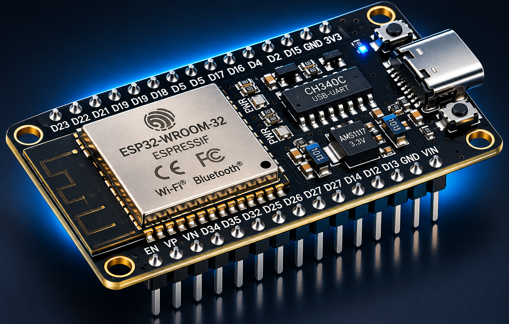
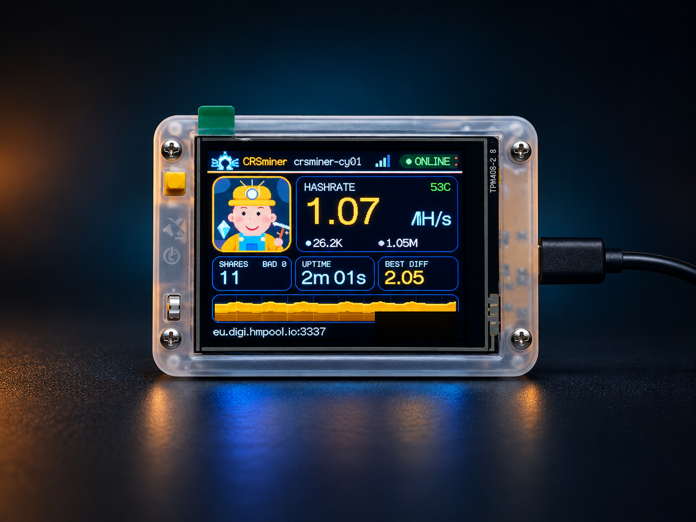
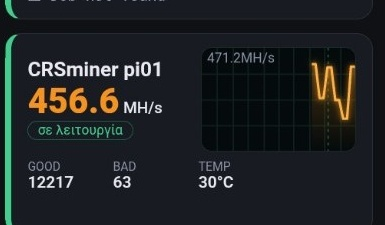
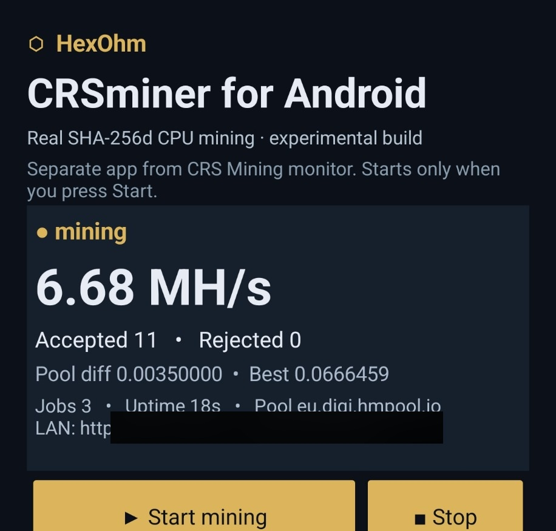
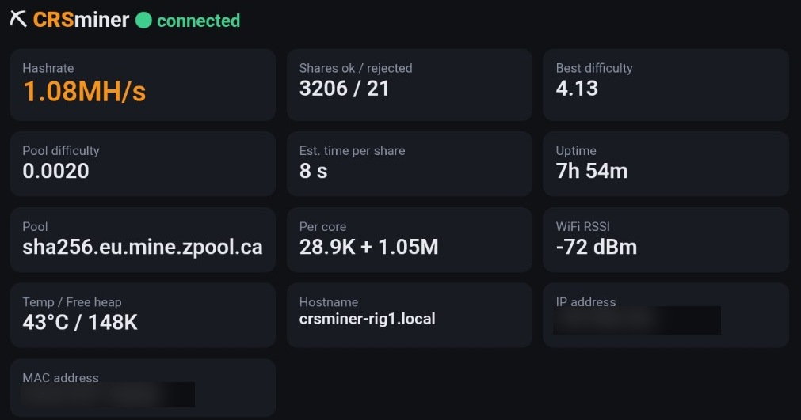
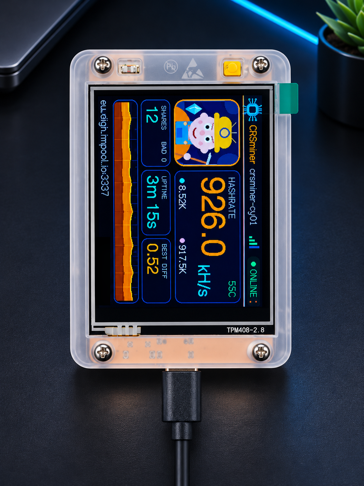
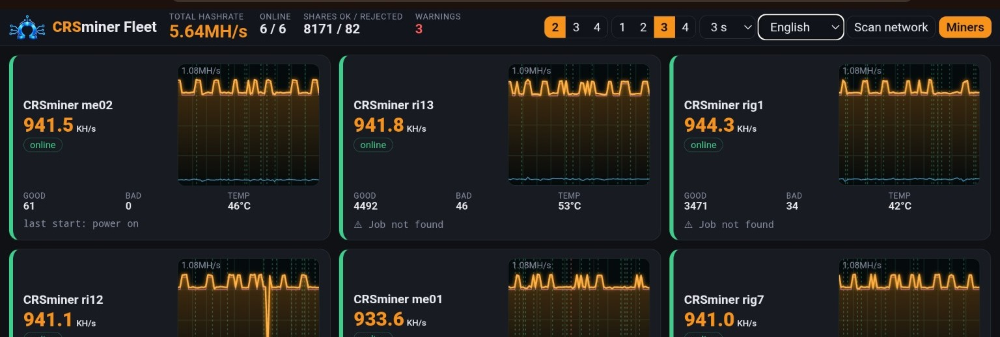
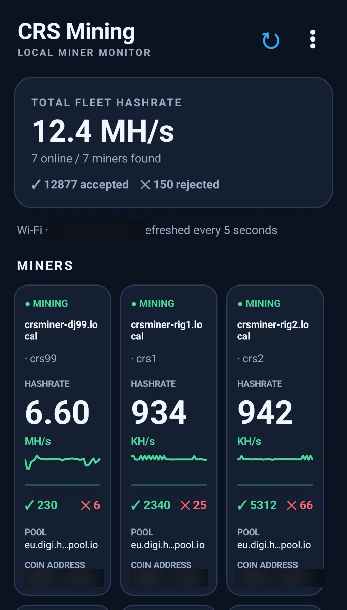

# CRSminer · HexOhm

**🇬🇷 Ελληνική τεκμηρίωση:** [Πλήρης οδηγός στα ελληνικά](README_GR.md) · [ESP32](docs/ESP32_USER_GUIDE_GR.md) · [CYD](docs/CYD_USER_GUIDE_GR.md) · [Raspberry Pi](firmware/Raspberry_Pi_USB_ASIC/README_GR.md) · [Android miner](firmware/Android_CPU_Miner_v0.4/README_GR.md) · [Monitors](docs/MONITORING_GR.md)

**Real SHA-256d mining on ESP32, CYD, Android CPU, Windows PC CPU, and Raspberry Pi + USB Block Erupter, with companion fleet monitors for Windows, Android and the browser.**

[**Get started**](#choose-your-miner) · [**Build the Raspberry Pi miner**](firmware/Raspberry_Pi_USB_ASIC/README.md) · [**Flash ESP32/CYD in your browser**](docs/FLASHING.md) · [**ESP32 operating guide**](docs/ESP32_USER_GUIDE.md) · [**CYD touch & screen guide**](docs/CYD_USER_GUIDE.md) · [**Οδηγίες στα Ελληνικά**](docs/ΠΡΟΓΡΑΜΜΑΤΙΣΜΟΣ_GR.md) · [**Android CPU miner**](#crsminer-for-android--cpu-mining) · [**Monitor your fleet**](#local-monitoring) · [**Implementation gallery**](docs/IMPLEMENTATIONS.md) · [**Android monitor versions**](monitoring/ANDROID_MONITOR_VERSIONS.md) · [**Source builds**](docs/BUILD_FROM_SOURCE.md)

  
  

<strong>Five working mining platforms · One HexOhm family · Local fleet monitoring</strong>

[**Windows PC CPU miner v0.2.3**](firmware/Windows_CPU_Miner_v0.2.3/README.md) · [**Οδηγίες στα Ελληνικά**](firmware/Windows_CPU_Miner_v0.2.3/README_GR.md)

**Project source and downloads.** The ESP32, CYD, Raspberry Pi, Android CPU miner and monitoring applications are the working editions confirmed by the project owner. Additional ESP board variants are outside this release. Source code and binaries are provided together wherever relevant.

> The studio device images are presentation artwork based on the actual hardware; use the board-specific flashing and hardware instructions, not artwork silkscreen, to determine compatibility.

## Choose your miner

**All five mining implementations are under [`firmware/`](firmware/README.md)**, including the Raspberry Pi USB ASIC scripts and the complete Android Studio CPU miner project. Monitoring applications are kept separately in [`monitoring/`](monitoring/).

| Mining device | Working edition | Source / setup | Ready-to-use files |
|---|---|---|---|
| Classic ESP32 | `CRSminer-14` | [Arduino sketch](firmware/ESP32/source/CRSminer/CRSminer.ino) | [Merged firmware](firmware/ESP32/merged/HexOhm_CRSminer_ESP32_Final_Merged.bin) |
| CYD display ESP32 | `CRSminer_CYD-18` | [Arduino sketch](firmware/CYD/source/CRSminer_CYD/CRSminer_CYD.ino) | [Merged firmware](firmware/CYD/merged/HexOhm_CRSminer_CYD_Final_Merged.bin) |
| Raspberry Pi + USB Block Erupter | `CRSminer Pi` · ~300 MH/s reported | [Complete installation guide & scripts](firmware/Raspberry_Pi_USB_ASIC/README.md) | [SD-card boot files](firmware/Raspberry_Pi_USB_ASIC/boot/) |
| Android phone CPU miner | `v0.4.0` · ~6.6 MH/s observed | [Complete Android Studio source](firmware/Android_CPU_Miner_v0.4/) | [Debug APK](firmware/Android_CPU_Miner_v0.4/apk/CRSminer_for_Android_v0.4.0-dev_DEBUG.apk) |
| Windows PC CPU miner | `v0.2.3` · SHA-NI / AVX2 / scalar C | [Source, builder & guide](firmware/Windows_CPU_Miner_v0.2.3/README.md) | Build `HexOhm_CRSminer_PC_v0.2.3.exe` locally on Windows x64; no prebuilt EXE |

| ESP32 | CYD (Cheap Yellow Display) |
|---|---|
|  |  |
| **Final tested build: `CRSminer-14`** | **Final tested build: `CRSminer_CYD-18`** |
| [Download merged `.bin`](firmware/ESP32/merged/HexOhm_CRSminer_ESP32_Final_Merged.bin) | [Download merged `.bin`](firmware/CYD/merged/HexOhm_CRSminer_CYD_Final_Merged.bin) |
| [Arduino sketch](firmware/ESP32/source/CRSminer/CRSminer.ino) · [Separate flash files](firmware/ESP32/advanced/) | [Arduino sketch](firmware/CYD/source/CRSminer_CYD/CRSminer_CYD.ino) · [Separate flash files](firmware/CYD/advanced/) |

### Raspberry Pi + USB Block Erupter — working USB ASIC miner

<table><tr><td width="42%">

</td><td>
<strong>CRSminer Pi — working hardware build</strong> 
Raspberry Pi running a USB Block Erupter via <strong>cgminer 3.7.2</strong>, with approximately <strong>300 MH/s</strong> reported during actual operation. The live screenshot shows a momentary reading from a separate session; speed can vary with the stick and mining conditions.  
<a href="firmware/Raspberry_Pi_USB_ASIC/README.md"><strong>Complete SD-card installation and first-boot build guide</strong></a> 
<a href="firmware/Raspberry_Pi_USB_ASIC/boot/">Installation scripts and example configuration</a>
</td></tr></table>

Unlike the ESP32 and CYD builds, this miner is **not flashed with a `.bin`**. The four supplied scripts/configuration files are copied to the Raspberry Pi OS Lite boot partition; the miner installs and compiles cgminer on first boot. The Pi also serves a compatible local `/api/status` endpoint for the fleet monitors.

The correct board matters: **do not exchange ESP32 and CYD binaries**. The CYD binary targets the specific two-USB-port ESP32-2432S028R ST7789 variant described in the sketch; other CYD versions may need recompilation.

## CRSminer for Android — CPU mining

<table><tr><td width="40%">

</td><td>
<strong>CRSminer for Android v0.4 · HexOhm</strong>  
A standalone Android miner, <strong>not</strong> the Android fleet-monitoring application. It performs real SHA-256d hashing on the phone CPU, connects to compatible Stratum V1 pools and submits shares. In the owner's on-device tests it reached roughly <strong>6.6 MH/s</strong>, with mining accepted by the pool.  
It provides configurable miner ID, worker, wallet and pool settings, adjustable CPU threads, an explicitly started foreground mining service and a resizable home-screen widget. While mining, the LAN status endpoint is available on <code>:8080/api/status</code> for compatible monitors.  
<a href="firmware/Android_CPU_Miner_v0.4/README.md"><strong>Android Studio source and build instructions</strong></a>
</td></tr></table>

**Android Studio is required to rebuild the app.** The user-supplied [Android miner v0.4.0-dev debug APK](firmware/Android_CPU_Miner_v0.4/apk/CRSminer_for_Android_v0.4.0-dev_DEBUG.apk) is also included for developer testing. This is a **debug build**, not a signed production release; source-to-binary reproducibility has not been independently verified. The included Android Studio source includes the latest supplied `MainActivity.java` input-field height fix and the existing startup fix; confirm the built result on the target device before distributing a signed APK. Like all CPU mining, it can consume significant battery and generate heat.

### ESP32 browser dashboard

*Live ESP32 telemetry, including per-core hashrate, shares, difficulty, temperature and pool status. Network identifiers have been concealed.*

## Operating instructions — ESP32 and CYD

After flashing, use these step-by-step guides for the first Wi-Fi/Stratum pool setup and daily operation:

- **[Classic ESP32 user guide](docs/ESP32_USER_GUIDE.md)** — WiFiManager onboarding, pool/wallet/worker, web dashboard, blue diagnostic LED modes, BOOT factory reset and troubleshooting.
- **[CYD user guide](docs/CYD_USER_GUIDE.md)** — CYD setup, touchscreen zones, **tap the miner mascot to turn off the backlight after two minutes (mining continues)**, tap elsewhere for system information, wake on touch, and RGB status indicators.

These are instructions for features **already present in the published builds**, not new firmware functionality.

## Flash without Arduino IDE

Open **[ESP Web Tool](https://esptool.spacehuhn.com/)** in a Web Serial–capable desktop browser (Chrome or Edge), connect your device by USB, and flash the *matching* merged firmware at **`0x0000`**. Each merged file is a complete **4 MB image**. Flashing it can **erase existing Wi-Fi and miner configuration**, so save your settings first.

For advanced users, the four files are also included in each target's `advanced/` folder:

| Flash address | File purpose |
|---|---|
| `0x1000` | Bootloader |
| `0x8000` | Partition table |
| `0xE000` | `boot_app0.bin` |
| `0x10000` | Application `.bin` |

Read the **[full illustrated-by-tables flashing instructions](docs/FLASHING.md)** before doing a separate-file upload. The two devices have **different partition tables**.

## CYD — on-device display

The CYD variant adds an on-device screen and real-time mining metrics. The example display presentation shows status, worker/miner name, hashrate, share counters, uptime and difficulty. Check compatibility with your exact CYD variant before flashing.

## Windows PC CPU miner — v0.2.3

[**CRSminer PC source and Windows EXE builder**](firmware/Windows_CPU_Miner_v0.2.3/README.md) · [Ελληνικός οδηγός](firmware/Windows_CPU_Miner_v0.2.3/README_GR.md)

A real SHA-256d CPU miner for old and modern **Windows x64** PCs, distinct from the Windows fleet monitor. Uses native SHA-NI, AVX2 or scalar engines when supported, individual logical-CPU effort, Background/Dedicated priority modes, optional CSV diagnostics, and a local `:8080/api/status` Fleet API. The owner's Ryzen 3 and AMD E-350 laptops both produced accepted pool shares and were visible in the browser Fleet Scanner. **It is source + builder and precompiled EXE for your convenience.**

## Local monitoring

**Android monitor version policy:** v1.2 is the confirmed working scanner; v1.3 source remains available for anyone who wants to build and test Android CPU miner discovery. The Android **CPU miner** itself is separately published as v0.4.0.

  
  

*Live dashboards from the working monitoring applications. The examples show actual fleet statistics; local-network and wallet values are concealed where they appear.*

| Component | Purpose | Included |
|---|---|---|
| [**CRS Mining Web for Windows v1.6.1**](monitoring/Windows_Web_v1.6.1/) | Staggered safe polling with manual discovery of ESP and compatible Android endpoints | Complete working package |
| [**CRS Mining Android Monitor v1.2**](monitoring/Android_Monitor_v1.2/) | Recommended working Android scanner for ESP miners over LAN (port 80) | Owner-tested source project |
| [**CRS Mining Android Monitor v1.3 development**](monitoring/Android_Monitor_v1.3/) | Optional port 8080 / Android CPU miner discovery enhancements | Experimental Android Studio source; not owner-tested |
| [**Browser Fleet Scanner**](monitoring/Browser_Fleet_Scanner/CRSminer-Fleet-Scan.html) | One-file bilingual HTML dashboard with adjustable layout and LAN scanning | Working HTML tool |

For the Windows monitor, **v1.6.1** is the published stable edition. For Android monitoring, **v1.2** remains the recommended tested edition, while [v1.3](monitoring/ANDROID_MONITOR_VERSIONS.md) is offered as optional development source. For manual full-network scans, follow the recommended conservative settings; device reliability is the priority.

See [Android Monitor versions](monitoring/ANDROID_MONITOR_VERSIONS.md) and [Monitoring](docs/MONITORING.md) for usage and [Implementation gallery](docs/IMPLEMENTATIONS.md) for the complete walkthrough and additional real screenshots.

The [CRSminer for Android CPU mining source](firmware/Android_CPU_Miner_v0.4/) is included separately from the [CRS Mining Android Monitor](monitoring/Android_Monitor_v1.2/). These are different applications, and neither is a substitute for the other.

## Hardware and functionality

- Real SHA-256d mining via compatible Stratum v1 pools over TCP.
- Hardware SHA on supported classic ESP32 silicon; fallback paths in code as documented in the source.
- WiFiManager setup, four-character miner IDs, configurable pool/wallet/worker and English/Greek web interface.
- Hashrate, accepted/rejected shares, best difficulty, device diagnostics and optional LED behavior.
- CYD live screen for supported display hardware.
- Working Raspberry Pi + USB Block Erupter (~300 MH/s reported), with cgminer 3.7.2 built on first boot.
- Android CPU miner v0.4 with real SHA-256d, foreground service, resizable widget and read-only HTTP status on port 8080.
- HTTP status endpoint `/api/status` on ESP and the Pi status-bridge design (network access only; not a public-facing service).

**Mining is intended for learning and experimentation, not a promise of profit.** These devices have negligible hashrate compared with modern commercial ASIC miners. Pool and wallet configuration is supplied by users. Mining draws energy and generates heat.

## Build / release details

- **ESP32 final source:** `CRSminer-14.ino` from the final archive, published in Arduino-compatible `CRSminer/CRSminer.ino` form.
- **CYD final source:** `CRSminer_CYD-18.ino` from the final archive, published in Arduino-compatible `CRSminer_CYD/CRSminer_CYD.ino` form.
- **Arduino ESP32 core 3.3.12**, 4 MB flash for both binaries. Exact flash maps are from the supplied builds.
- **Android miner source and debug APK:** `firmware/Android_CPU_Miner_v0.4/` — recovered v0.4 Android Studio project including the startup and input-height corrections. See its [build notes](firmware/Android_CPU_Miner_v0.4/README.md). The supplied project labels its version `0.4.0-dev`; the corresponding user-supplied debug APK is provided for testing, but there is no signed production APK.
- **Raspberry Pi working source:** the supplied four boot files, unchanged from the project owner's `CRSminer_Pi_usbAsic.zip`, with the setup instructions documented [here](firmware/Raspberry_Pi_USB_ASIC/README.md). No precompiled cgminer is bundled.
- The ESP32/CYD source files and firmware binaries have been retained byte for byte from the working builds supplied by HexOhm. The Android miner source includes only the previously requested input-field sizing correction on top of its archived startup-fixed source.
- Checksums are available in [`SHA256SUMS.txt`](SHA256SUMS.txt).
- License: [MIT](LICENSE) for the included HexOhm code, with [third-party attributions](CREDITS.md); externally obtained **cgminer is GPL-3.0** and **not redistributed** in this repository.

## More information

[Flashing guide](docs/FLASHING.md) · [Monitoring comparison](docs/MONITORING.md) · [Included releases](docs/VERSIONS_AND_STATUS.md) · [Privacy and safe sharing](docs/SECURITY_AND_PRIVACY.md) · [First publication checklist](docs/RELEASE_CHECKLIST.md)

© 2026 **HexOhm**.
