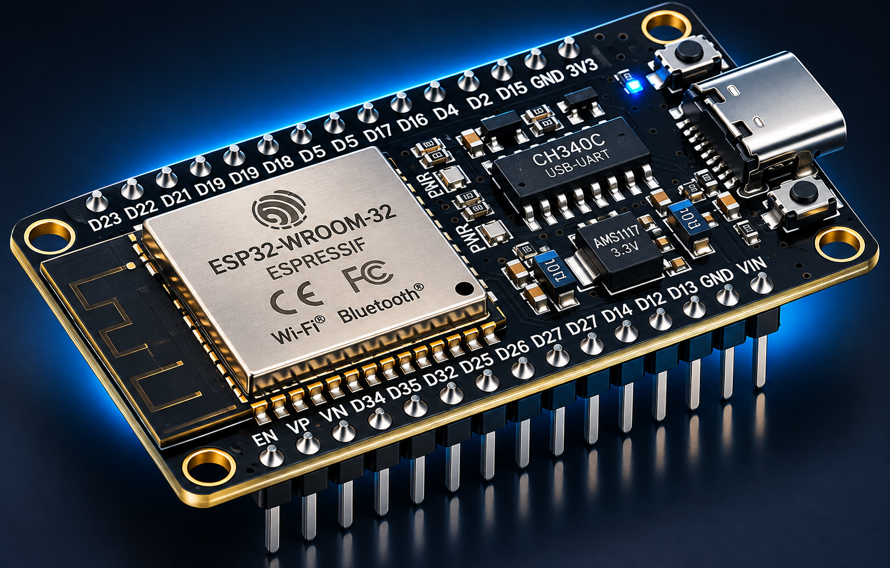
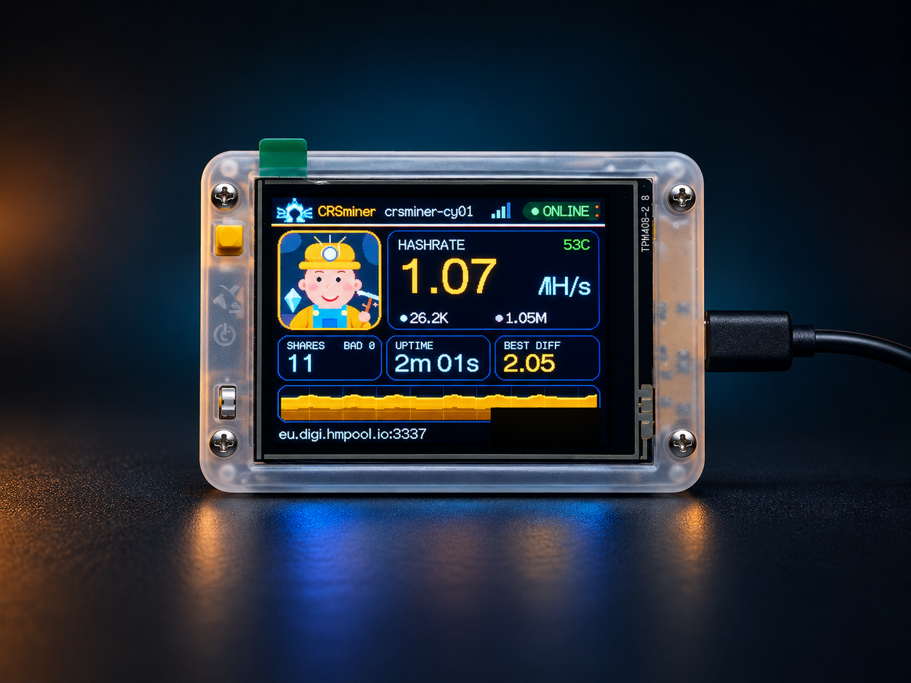
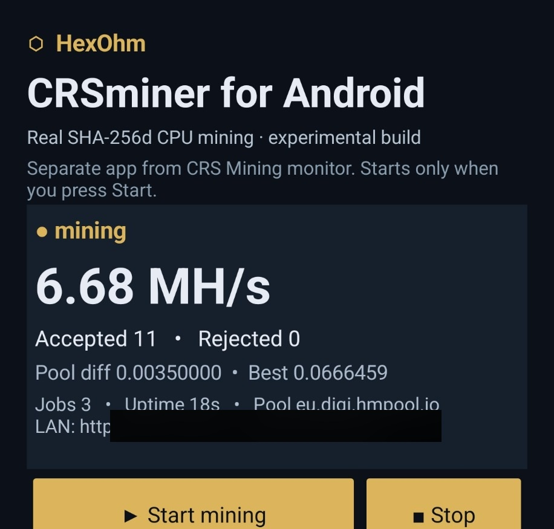
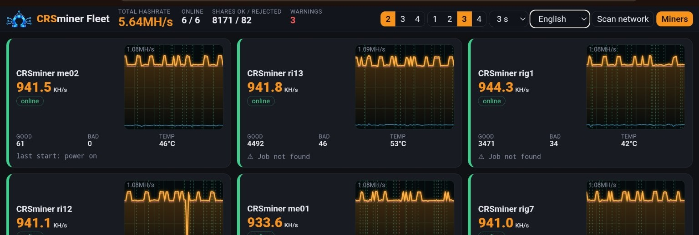
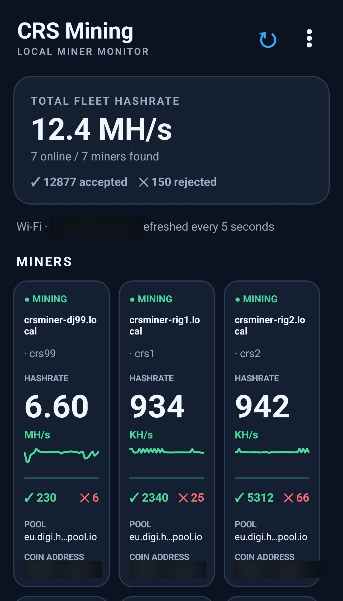

# CRSminer · HexOhm — Ελληνικός οδηγός

[**English — README.md**](README.md) · [**Εγκατάσταση ESP32**](docs/ESP32_USER_GUIDE_GR.md) · [**Εγκατάσταση CYD**](docs/CYD_USER_GUIDE_GR.md) · [**Raspberry Pi + USB ASIC**](firmware/Raspberry_Pi_USB_ASIC/README_GR.md) · [**Android CPU miner**](firmware/Android_CPU_Miner_v0.4/README_GR.md) · [**Εργαλεία monitoring**](docs/MONITORING_GR.md)

**Οικογένεια συσκευών πραγματικής εξόρυξης SHA-256d** με ESP32, CYD, Raspberry Pi + USB Block Erupter και Android CPU miner, καθώς και εφαρμογές παρακολούθησης για Windows, Android και browser.

 

**Τέσσερις υλοποιήσεις mining, μία οικογένεια HexOhm.** Οι καλλωπισμένες φωτογραφίες είναι εικόνες παρουσίασης. Για σύνδεση και συμβατότητα ακολουθήστε τις οδηγίες κάθε πλακέτας, όχι τις λεπτομέρειες που τυχόν φαίνονται στις εικόνες.

## Επιλέξτε miner

| Συσκευή | Έκδοση | Πηγαίος κώδικας / οδηγός | Έτοιμο αρχείο |
|---|---|---|---|
| **Κλασικό ESP32** | `CRSminer-14` | [Οδηγός](docs/ESP32_USER_GUIDE_GR.md) · [Arduino `.ino`](firmware/ESP32/source/CRSminer/CRSminer.ino) | [Πλήρες `.bin`](firmware/ESP32/merged/HexOhm_CRSminer_ESP32_Final_Merged.bin) |
| **CYD με οθόνη αφής** | `CRSminer_CYD-18` | [Οδηγός](docs/CYD_USER_GUIDE_GR.md) · [Arduino `.ino`](firmware/CYD/source/CRSminer_CYD/CRSminer_CYD.ino) | [Πλήρες `.bin`](firmware/CYD/merged/HexOhm_CRSminer_CYD_Final_Merged.bin) |
| **Raspberry Pi + USB Block Erupter** | CRSminer Pi, ~300 MH/s αναφερόμενα | [Αναλυτική εγκατάσταση στα ελληνικά](firmware/Raspberry_Pi_USB_ASIC/README_GR.md) | [Τέσσερα αρχεία εκκίνησης](firmware/Raspberry_Pi_USB_ASIC/boot/) |
| **Android CPU miner** | `0.4.0-dev`, ~6,6 MH/s παρατηρήθηκαν | [Κώδικας Android Studio και οδηγός](firmware/Android_CPU_Miner_v0.4/README_GR.md) | [Debug APK](firmware/Android_CPU_Miner_v0.4/apk/CRSminer_for_Android_v0.4.0-dev_DEBUG.apk) |

Ο κώδικας των τεσσάρων miners βρίσκεται στο [`firmware/`](firmware/README_GR.md). Οι ξεχωριστές εφαρμογές παρακολούθησης είναι στο [`monitoring/`](docs/MONITORING_GR.md).

## Εγκατάσταση ESP32/CYD

Χρησιμοποιήστε το [ESP Web Tool](https://esptool.spacehuhn.com/) σε Chrome/Edge υπολογιστή με κατάλληλο USB καλώδιο. **Πλήρες merged image: διεύθυνση `0x0000`**, χωρητικότητα 4 MiB. Τα ξεχωριστά αρχεία flash χρησιμοποιούν διευθύνσεις `0x1000` (bootloader), `0x8000` (partition table), `0xe000` (`boot_app0.bin`) και `0x10000` (application).

**Μην ανταλλάσσετε τα δύο binaries.** Η CYD έκδοση προορίζεται για τη συγκεκριμένη πλακέτα **δύο θυρών USB / ST7789**. Η εγκατάσταση του πλήρους image μπορεί να σβήσει τις υπάρχουσες ρυθμίσεις Wi-Fi και pool. Δείτε τις [πλήρεις οδηγίες flashing](docs/FLASHING_GR.md).

Μετά την εγκατάσταση, το WiFiManager επιτρέπει τη ρύθμιση Wi-Fi, ονόματος miner τεσσάρων χαρακτήρων, Stratum pool, wallet, worker, LED και γλώσσας. Ανοίξτε το dashboard στη διεύθυνση `http://crsminer-NAME.local/` ή στην IP της συσκευής (όπου `NAME` το τετραγράμματο ID).

### Diagnostic LED ESP32

Στην επιλογή **Diagnostic** το LED αναβοσβήνει για τα πρώτα **20 δευτερόλεπτα**. Στη συνέχεια σβήνει αν δεν υπάρχει διαγνωστικό πρόβλημα· **σταθερό άναμμα σημαίνει ότι απαιτείται έλεγχος**. Υπάρχουν επίσης οι επιλογές On και Off. Προσοχή στο σωστό GPIO για την πλακέτα. [Όλες οι λεπτομέρειες](docs/ESP32_USER_GUIDE_GR.md).

### CYD — χειρισμός αφής

- **Άγγιγμα πάνω στον χαρακτήρα miner (mascot)** στην κύρια οθόνη: μετά από **2 λεπτά** σβήνει ο φωτισμός· το mining συνεχίζεται.
- **Άγγιγμα αλλού:** εναλλαγή κύριας σελίδας και σελίδας γενικών πληροφοριών (Host, IP, MAC, Pool, Wi-Fi, Chip, Cores, Status).
- **Άγγιγμα στη σβηστή οθόνη:** επαναφορά φωτισμού χωρίς ταυτόχρονη αλλαγή σελίδας.

Δείτε τον [πλήρη οδηγό CYD](docs/CYD_USER_GUIDE_GR.md) για την ενδεικτική RGB LED, τα shares και την αρχική εγκατάσταση.

## Raspberry Pi + USB Block Erupter

Η έκδοση Raspberry Pi χρησιμοποιεί USB Block Erupter ASIC με **cgminer 3.7.2**. Η αναφερόμενη απόδοση είναι περίπου **300 MH/s**. Το cgminer δεν διανέμεται στο repository: μεταγλωττίζεται από τα scripts κατά την πρώτη εκκίνηση. Δεν χρειάζεται flashing `.bin`. Δείτε [βήμα-βήμα την εγκατάσταση κάρτας SD](firmware/Raspberry_Pi_USB_ASIC/README_GR.md).

## CRSminer for Android — πραγματικό CPU mining

Το **CRSminer for Android v0.4.0** δεν είναι η εφαρμογή παρακολούθησης. Εξορύσσει με τη CPU του κινητού μέσω native C++/JNI και Stratum V1, με ρυθμιζόμενα threads, pool/solo pool, worker, wallet, foreground service, widget και endpoint `/api/status` στη **θύρα 8080**. Περιλαμβάνεται [ολόκληρο το Android Studio project](firmware/Android_CPU_Miner_v0.4/README_GR.md) και **debug APK**, όχι υπογεγραμμένο production release. Το CPU mining επιβαρύνει τη μπαταρία και παράγει θερμότητα.

## Εφαρμογές παρακολούθησης

 

| Εφαρμογή | Κατάσταση / δυνατότητες |
|---|---|
| [Windows Web Monitor v1.6.1](monitoring/Windows_Web_v1.6.1/README_GR.md) | Προτεινόμενη δοκιμασμένη έκδοση, προσεκτικό polling και χειροκίνητο scan |
| [Android Monitor v1.2](monitoring/Android_Monitor_v1.2/README_GR.md) | **Δοκιμασμένη** έκδοση scanner για ESP στη θύρα 80 |
| [Android Monitor v1.3](monitoring/Android_Monitor_v1.3/README_GR.md) | **Πειραματικός πηγαίος κώδικας**, όχι δοκιμασμένος από τον δημιουργό, με προαιρετική ανίχνευση θύρας 8080 |
| [Browser Fleet Scanner](monitoring/Browser_Fleet_Scanner/CRSminer-Fleet-Scan.html) | Αυτόνομο δίγλωσσο HTML εργαλείο· [οδηγίες](monitoring/Browser_Fleet_Scanner/README_GR.md) |

Ο Android Monitor είναι **διαφορετική** εφαρμογή από τον Android CPU miner. [Σύγκριση εκδόσεων Android Monitor](monitoring/ANDROID_MONITOR_VERSIONS_GR.md).

## Περισσότερη τεκμηρίωση στα ελληνικά

[Γκαλερί υλοποιήσεων](docs/IMPLEMENTATIONS_GR.md) · [Flashing](docs/FLASHING_GR.md) · [Μεταγλώττιση από πηγαίο κώδικα](docs/BUILD_FROM_SOURCE_GR.md) · [Παρακολούθηση](docs/MONITORING_GR.md) · [Εκδόσεις](docs/VERSIONS_AND_STATUS_GR.md) · [Ασφάλεια και ιδιωτικότητα](docs/SECURITY_AND_PRIVACY_GR.md) · [Λίστα ελέγχου δημοσίευσης](docs/RELEASE_CHECKLIST_GR.md) · [Credits και άδειες](CREDITS_GR.md).

**Σκοπός:** εκπαίδευση και πειραματισμός, όχι εγγύηση κέρδους. Τα στοιχεία πρόσβασης και η διεύθυνση wallet πρέπει να διαχειρίζονται με προσοχή. Οι υπηρεσίες τοπικού δικτύου δεν πρέπει να εκτίθενται στο Internet.

© 2026 **HexOhm** · Ανάπτυξη με τη συνδρομή **AI**.
