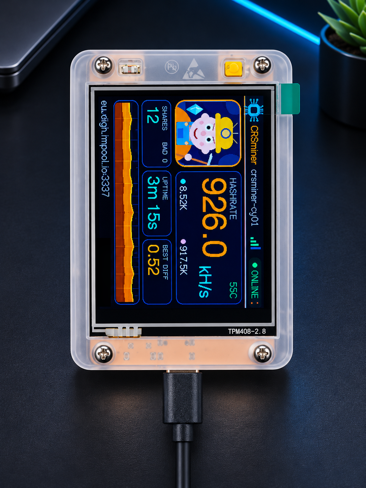
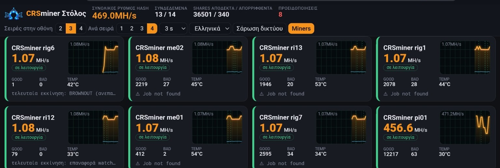

# CRSminer — implementation gallery

The screenshots below document the actual working CRSminer applications. Personal network identifiers and wallet strings have been concealed in publication images. Hardware presentation images are edited artwork, not wiring diagrams.

## 1 · Classic ESP32 SHA-256d miner

The classic ESP32 runs the SHA-256d mining firmware, with a local status dashboard and Stratum pool connection. The working release is **CRSminer-14**, available as source and flash binaries.

The status page shows hashrate, accepted/rejected shares, difficulty, uptime, pool, per-core activity, temperature and network telemetry.

[ESP32 firmware](../firmware/ESP32/) · [Flashing instructions](FLASHING.md)

## 2 · CYD miner with on-board display

The **CRSminer_CYD-18** edition puts live mining statistics on the supported CYD display. The two studio images show the device and its display in portrait and landscape orientations; both are presentation artwork based on the actual miner.

[CYD firmware](../firmware/CYD/) · [CYD flashing](FLASHING.md)

## 3 · Raspberry Pi USB Block Erupter miner — real mining

This is the owner's **working Raspberry Pi + USB Block Erupter** implementation, reporting approximately **300 MH/s** in normal use. The pictured `crsminer-pi01` is an actual device detected by the fleet-monitor software; its instantaneous display reading may differ from the typical figure.

Unlike the ESP32 boards, the Raspberry Pi uses a USB ASIC for hashing and runs **cgminer 3.7.2** built locally during first-boot setup. A Python bridge exposes `/api/status` for the same LAN fleet interface.

For the full Raspberry Pi OS Lite (32-bit) SD-card setup, Wi-Fi and pool configuration, one-time installer, cgminer build and troubleshooting, see the **[Raspberry Pi build and installation guide](../firmware/Raspberry_Pi_USB_ASIC/README.md)**. The supplied runtime scripts are unchanged.

## 4 · CRSminer for Android — real CPU miner

**This is a miner, not the Android fleet-monitor app.** The owner's tested Android application performs real SHA-256d using native C++/JNI hashing, submits Stratum V1 shares and shows live accepted/rejected shares, difficulty and hashrate. Its Android Studio source package is included at [firmware/Android_CPU_Miner_v0.4](../firmware/Android_CPU_Miner_v0.4/).

In real use it reached approximately **6.6 MH/s** on the tested phone. Users can configure their own worker ID, payout address, pool, thread count and choose to start or stop mining. It supports foreground operation, a resizable HexOhm widget and a local `/api/status` endpoint on **port 8080** so the Android and Windows monitors can discover it alongside the ESP devices. The public screenshot conceals the local address.

The source archive preserves the earlier startup fix and a density-independent correction to the input-field heights. The author's [debug APK v0.4.0-dev](../firmware/Android_CPU_Miner_v0.4/apk/CRSminer_for_Android_v0.4.0-dev_DEBUG.apk) is included for developer testing, not represented as a signed production release. Building needs Android Studio, the Android SDK, NDK and CMake. CPU mining generates heat and increases battery consumption.

## 5 · Browser Fleet Scanner

The standalone [CRSminer-Fleet-Scan HTML](../monitoring/Browser_Fleet_Scanner/CRSminer-Fleet-Scan.html) offers English/Greek UI, responsive tiles, hashrate traces, summary statistics and manual LAN discovery. Follow its local-network scan instructions and avoid unnecessary repeated full subnet scans.

## 6 · Android Fleet Monitor

The recommended [Android Monitor v1.2 source](../monitoring/Android_Monitor_v1.2/) provides the working mobile fleet scanner used by HexOhm, showing local ESP miners and their current activity. A separate [Android Monitor v1.3 development source](../monitoring/Android_Monitor_v1.3/) is available for developers who wish to test expanded discovery of Android CPU mining endpoints on port 8080. The author has not tested v1.3; [see the comparison](../monitoring/ANDROID_MONITOR_VERSIONS.md).

## 7 · Windows Web Monitor — safe monitoring

The published [Windows Web v1.6.1](../monitoring/Windows_Web_v1.6.1/) uses conservative discovery and staggered polling. Monitoring supports a mixed fleet with ESP and compatible Android status endpoints.

The mixed-fleet screenshot above also shows the **working** Raspberry Pi USB ASIC miner alongside ESP32 devices. The Pi is an independent miner, not just a monitor. Its backend is documented in the Raspberry Pi section above.
