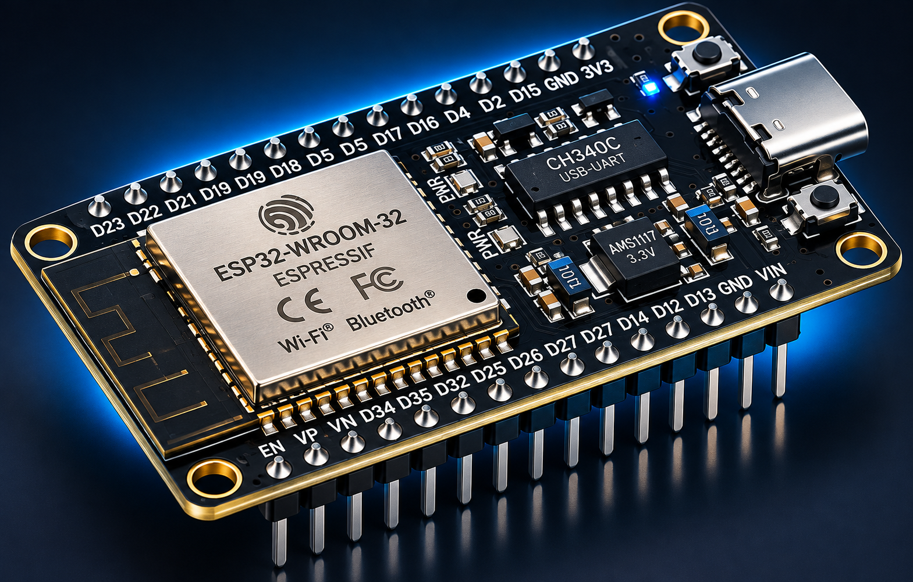
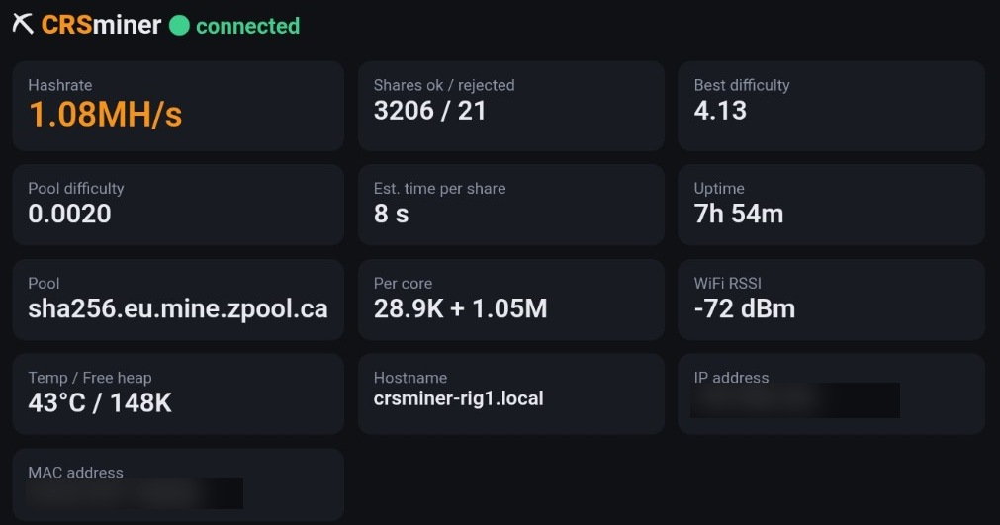
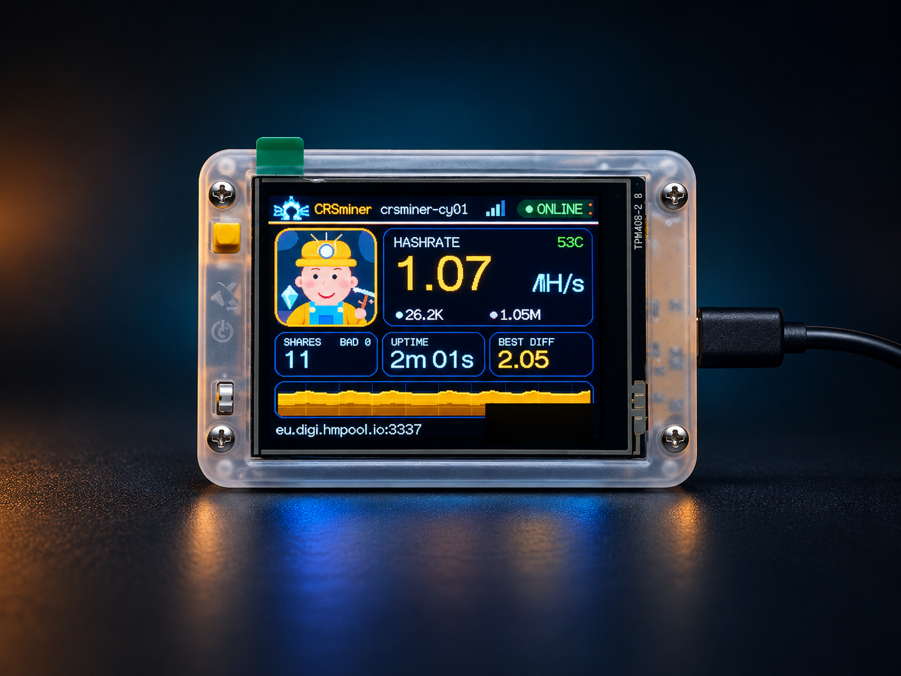
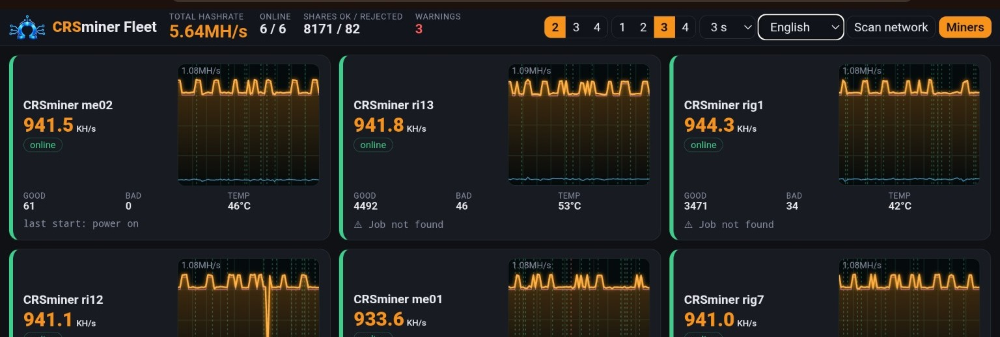
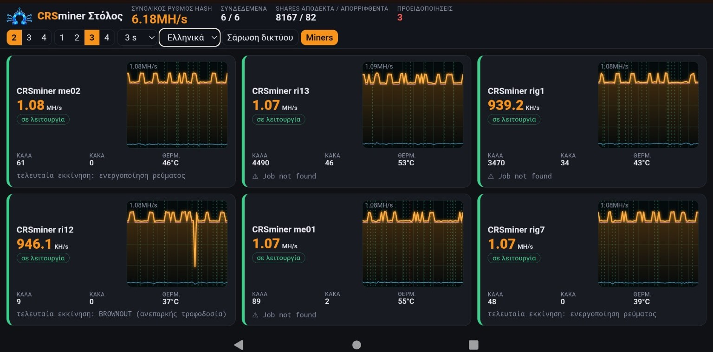
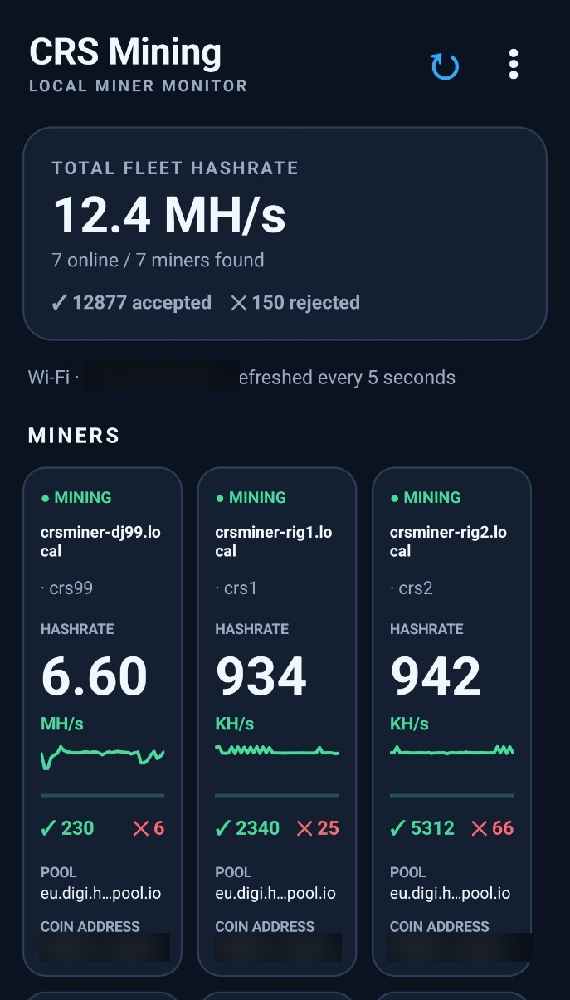

# CRSminer — implementation gallery

The screenshots below document the actual working CRSminer applications. Personal network identifiers and wallet strings have been concealed in publication images. Hardware presentation images are edited artwork, not wiring diagrams.

## 1 · Classic ESP32 SHA-256d miner

The classic ESP32 runs the SHA-256d mining firmware, with a local status dashboard and Stratum pool connection. The working release is **CRSminer-14**, available as source and flash binaries.

The status page shows hashrate, accepted/rejected shares, difficulty, uptime, pool, per-core activity, temperature and network telemetry.

[ESP32 firmware](../firmware/ESP32/) · [Flashing instructions](FLASHING.md)

## 2 · CYD miner with on-board display

The **CRSminer_CYD-18** edition puts live mining statistics on the supported CYD display. The two studio images show the device and its display in portrait and landscape orientations; both are presentation artwork based on the actual miner.

[CYD firmware](../firmware/CYD/) · [CYD flashing](FLASHING.md)

## 3 · Browser Fleet Scanner

The standalone [CRSminer-Fleet-Scan HTML](../monitoring/Browser_Fleet_Scanner/CRSminer-Fleet-Scan.html) offers English/Greek UI, responsive tiles, hashrate traces, summary statistics and manual LAN discovery. Follow its local-network scan instructions and avoid unnecessary repeated full subnet scans.

## 4 · Android Fleet Monitor

The [Android Monitor source](../monitoring/Android_Monitor_v1.3/) provides the working mobile fleet monitor, showing local CRSminer devices and their current activity.

## 5 · Raspberry Pi USB Block Erupter miner — real mining

This is the owner's **working Raspberry Pi + USB Block Erupter** implementation, reporting approximately **300 MH/s** in normal use. The pictured `crsminer-pi01` is an actual device detected by the fleet-monitor software; its instantaneous display reading may differ from the typical figure.

Unlike the ESP32 boards, the Raspberry Pi uses a USB ASIC for hashing and runs **cgminer 3.7.2** built locally during first-boot setup. A Python bridge exposes `/api/status` for the same LAN fleet interface.

For the full Raspberry Pi OS Lite (32-bit) SD-card setup, Wi-Fi and pool configuration, one-time installer, cgminer build and troubleshooting, see the **[Raspberry Pi build and installation guide](../monitoring/Raspberry_Pi_USB_ASIC/README.md)**. The supplied runtime scripts are unchanged.

## 6 · Windows Web Monitor — safe monitoring

The published [Windows Web v1.6.1](../monitoring/Windows_Web_v1.6.1/) uses conservative discovery and staggered polling. Monitoring supports a mixed fleet with ESP and compatible Android status endpoints.

The mixed-fleet screenshot above also shows the **working** Raspberry Pi USB ASIC miner alongside ESP32 devices. The Pi is an independent miner, not just a monitor. Its backend is documented in the Raspberry Pi section above.
