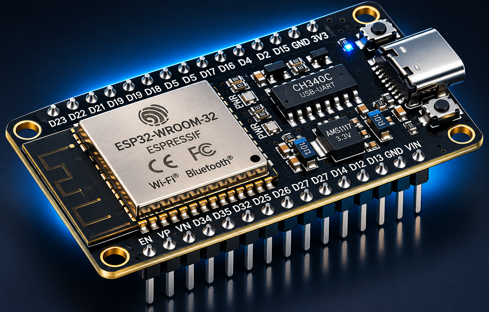
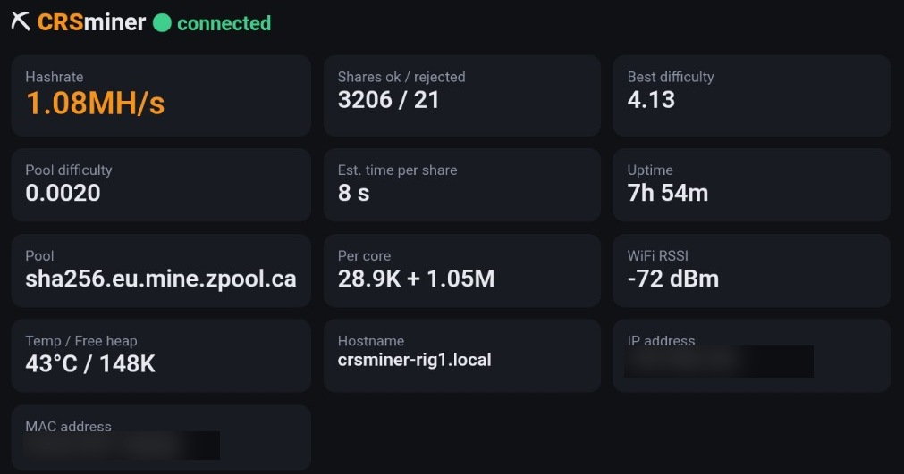
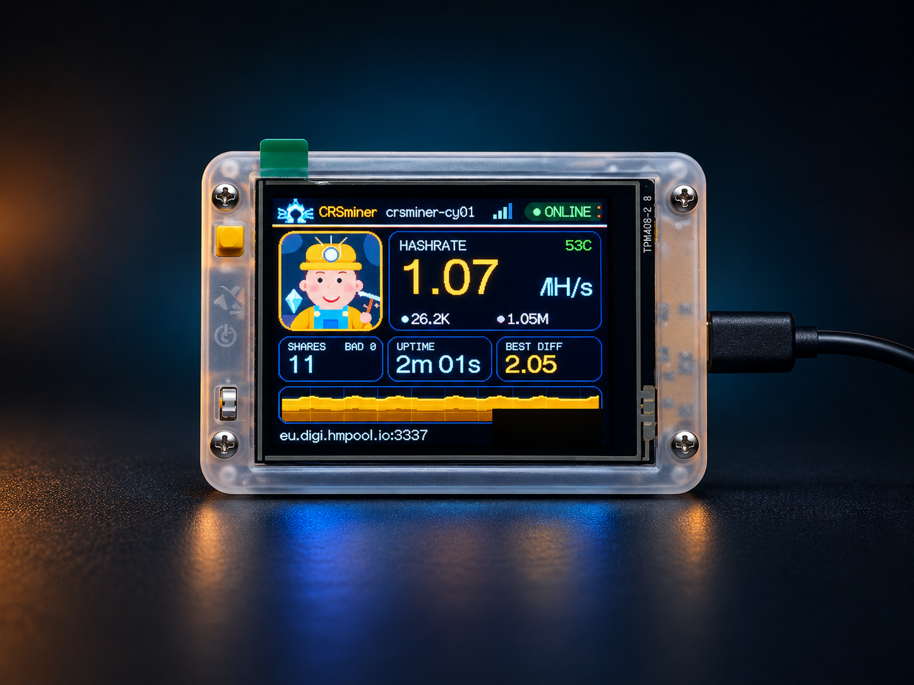
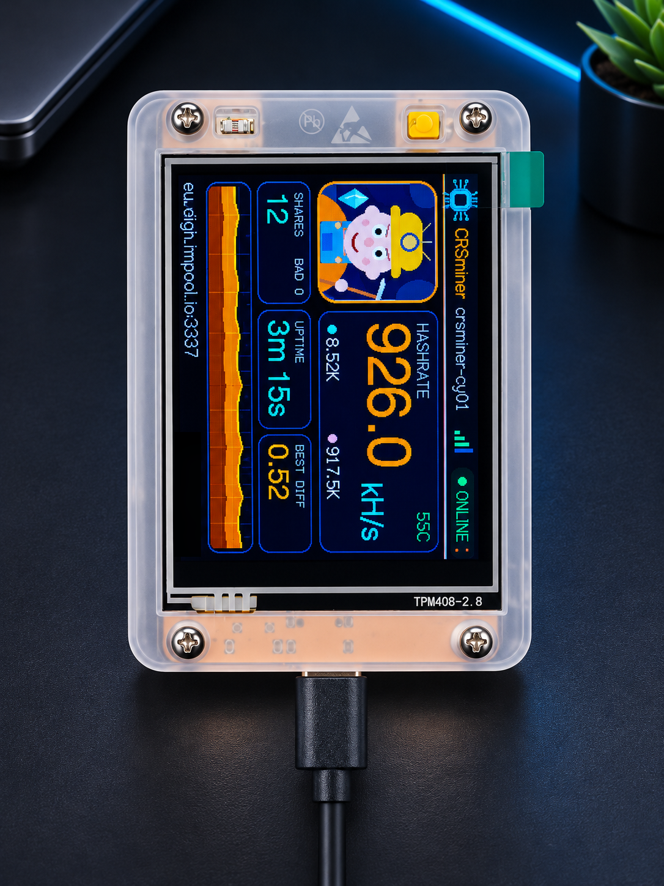
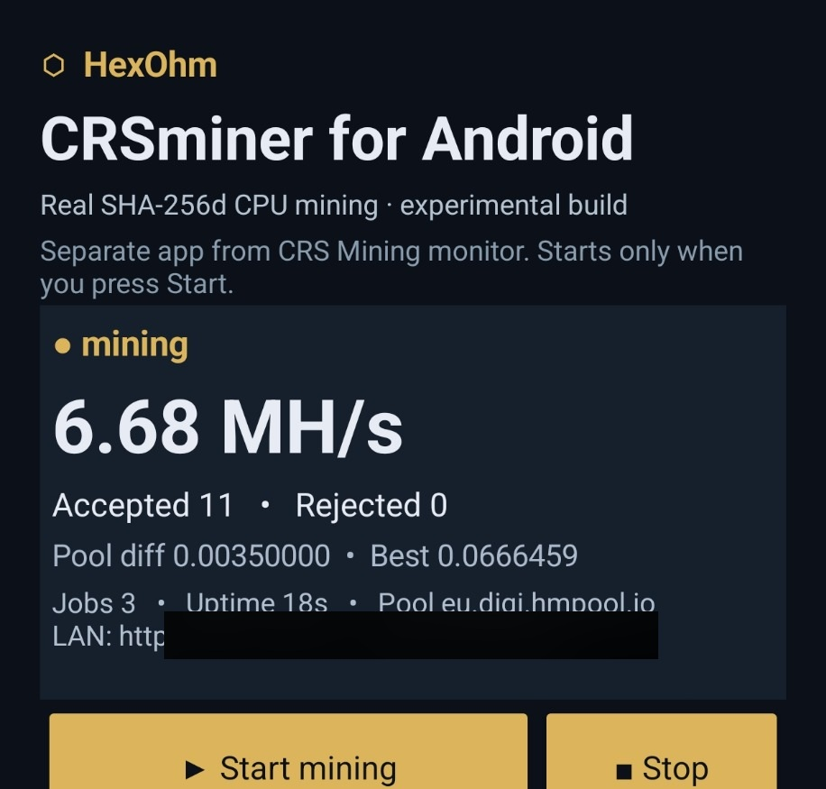
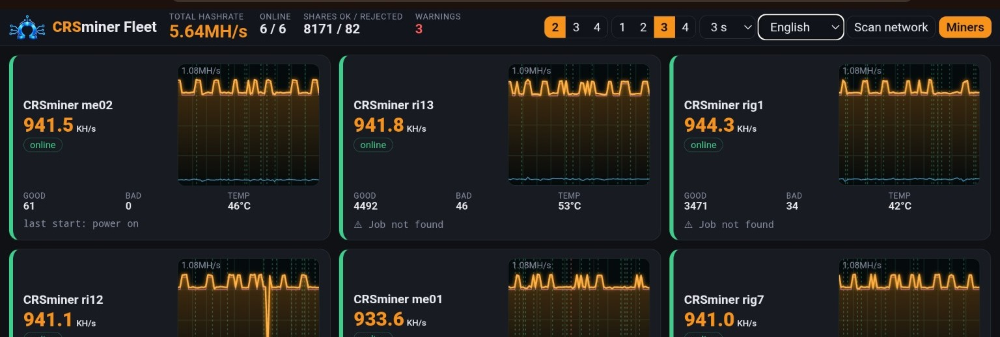
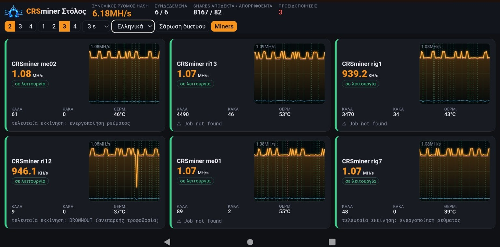
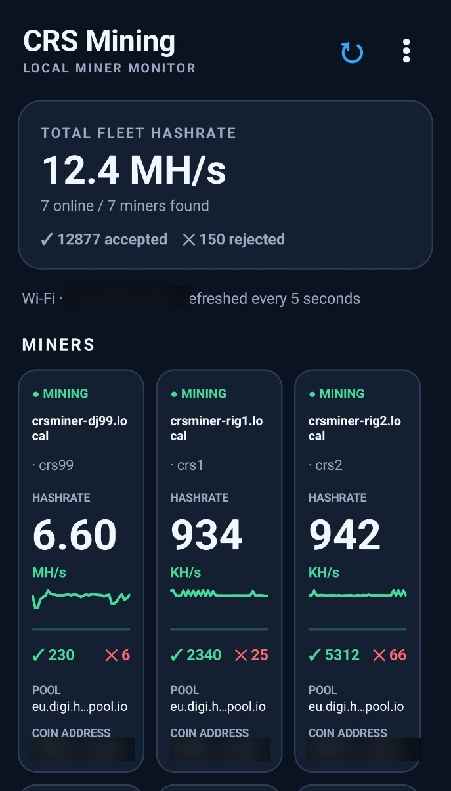
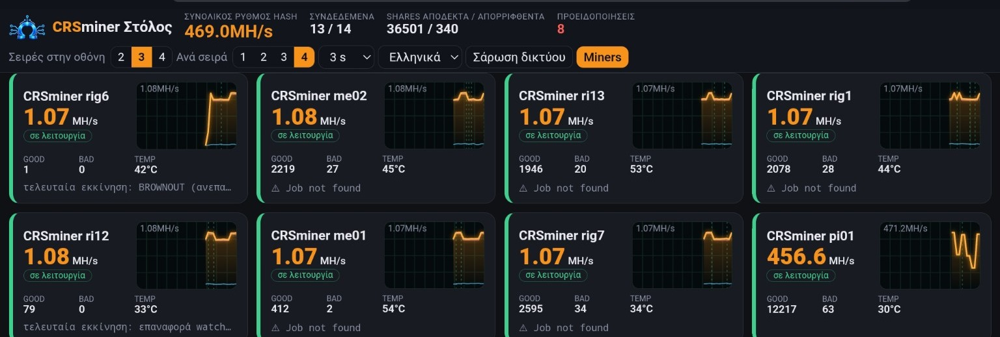

# CRSminer — Παρουσίαση των υλοποιήσεων

[English](IMPLEMENTATIONS.md) · [Ελληνική κεντρική σελίδα](../README_GR.md)

Οι παρακάτω εικόνες παρουσιάζουν λειτουργικές υλοποιήσεις και πραγματικά στιγμιότυπα. Σε δημόσιες εικόνες έχουν καλυφθεί στοιχεία δικτύου και wallet. Οι ωραιοποιημένες εικόνες hardware είναι παρουσίαση και όχι σχέδια καλωδίωσης.

## 1. Κλασικό ESP32 — SHA-256d mining

Το **CRSminer-14** συνδέεται με Stratum pool, χρησιμοποιεί SHA-256d και προσφέρει ενσωματωμένο web dashboard για hashrate, shares, δυσκολία, διάρκεια λειτουργίας, Wi-Fi, θερμοκρασία και διαγνωστικά.

[Κώδικας ESP32](../firmware/ESP32/source/CRSminer/CRSminer.ino) · [Οδηγός λειτουργίας ESP32](ESP32_USER_GUIDE_GR.md) · [Flashing](FLASHING_GR.md)

## 2. CYD — εξόρυξη με οθόνη αφής

Η έκδοση **CRSminer_CYD-18** εμφανίζει τα στοιχεία του miner στην ενσωματωμένη οθόνη. Ένα άγγιγμα έξω από τον χαρακτήρα miner εναλλάσσει την κύρια σελίδα με τη σελίδα Host/IP/MAC/Pool/Wi-Fi/Chip/Cores/Status. Άγγιγμα στον χαρακτήρα προγραμματίζει σβήσιμο του backlight μετά δύο λεπτά, χωρίς διακοπή εξόρυξης· άγγιγμα σβηστής οθόνης την αφυπνίζει.

[Κώδικας CYD](../firmware/CYD/source/CRSminer_CYD/CRSminer_CYD.ino) · [Οδηγός αφής/λειτουργίας](CYD_USER_GUIDE_GR.md)

## 3. Raspberry Pi + USB Block Erupter

Πραγματική εξόρυξη με **USB ASIC** και **cgminer 3.7.2**, σε Raspberry Pi. Ο δημιουργός αναφέρει περίπου **300 MH/s**. Το Raspberry Pi εκτελεί τα scripts εγκατάστασης και status API, ενώ το USB Block Erupter υπολογίζει τα hashes. Η ένδειξη στιγμιοτύπου μπορεί να διαφέρει από τον μέσο ρυθμό.

[Οδηγίες Raspberry Pi και αρχεία εγκατάστασης](../firmware/Raspberry_Pi_USB_ASIC/README_GR.md)

## 4. CRSminer for Android — CPU miner

Το **Android CPU miner v0.4.0** είναι ανεξάρτητη εφαρμογή εξόρυξης SHA-256d (και **όχι** ο Android Monitor). Ο κώδικας Java και native C++/JNI συνδέεται με Stratum V1, υπολογίζει hashes και στέλνει shares. Ο δημιουργός αναφέρει περίπου **6,6 MH/s** σε πραγματικό κινητό. Περιλαμβάνει foreground service, widget και τοπικό endpoint `:8080/api/status`.

[Πλήρης πηγαίος κώδικας και build](../firmware/Android_CPU_Miner_v0.4/README_GR.md) · [Debug APK](../firmware/Android_CPU_Miner_v0.4/apk/CRSminer_for_Android_v0.4.0-dev_DEBUG.apk)

## 5. Browser Fleet Scanner

Αυτόνομο αρχείο HTML για LAN αναζήτηση, γραφήματα hashrate και συνολικά στατιστικά, με υποστήριξη ελληνικών/αγγλικών. Χρησιμοποιήστε χειροκίνητα και με μέτρο το πλήρες subnet scan, ώστε να μην επιβαρύνονται οι μικροί web servers των ESP.

[Άνοιγμα του HTML scanner](../monitoring/Browser_Fleet_Scanner/CRSminer-Fleet-Scan.html) · [Οδηγίες στα ελληνικά](../monitoring/Browser_Fleet_Scanner/README_GR.md)

## 6. Android Fleet Monitor

Η **v1.2** είναι η δοκιμασμένη εφαρμογή σάρωσης/παρακολούθησης για ESP στη θύρα 80. Η **v1.3** διατίθεται ως πειραματικός κώδικας για αναγνώριση Android miner στη θύρα 8080, **χωρίς επιβεβαίωση λειτουργίας από τον δημιουργό**.

[Οδηγός v1.2](../monitoring/Android_Monitor_v1.2/README_GR.md) · [Οδηγός ανάπτυξης v1.3](../monitoring/Android_Monitor_v1.3/README_GR.md)

## 7. Windows Web Monitor v1.6.1

Η προτεινόμενη, δοκιμασμένη έκδοση χρησιμοποιεί συντηρητική ανακάλυψη και χρονικά κατανεμημένα αιτήματα HTTP, χωρίς αυτόματο πλήρες scan υποδικτύου. Το screenshot δείχνει και το Pi USB ASIC ως ανεξάρτητο miner.

[Οδηγός Windows Web](../monitoring/Windows_Web_v1.6.1/README_GR.md)
